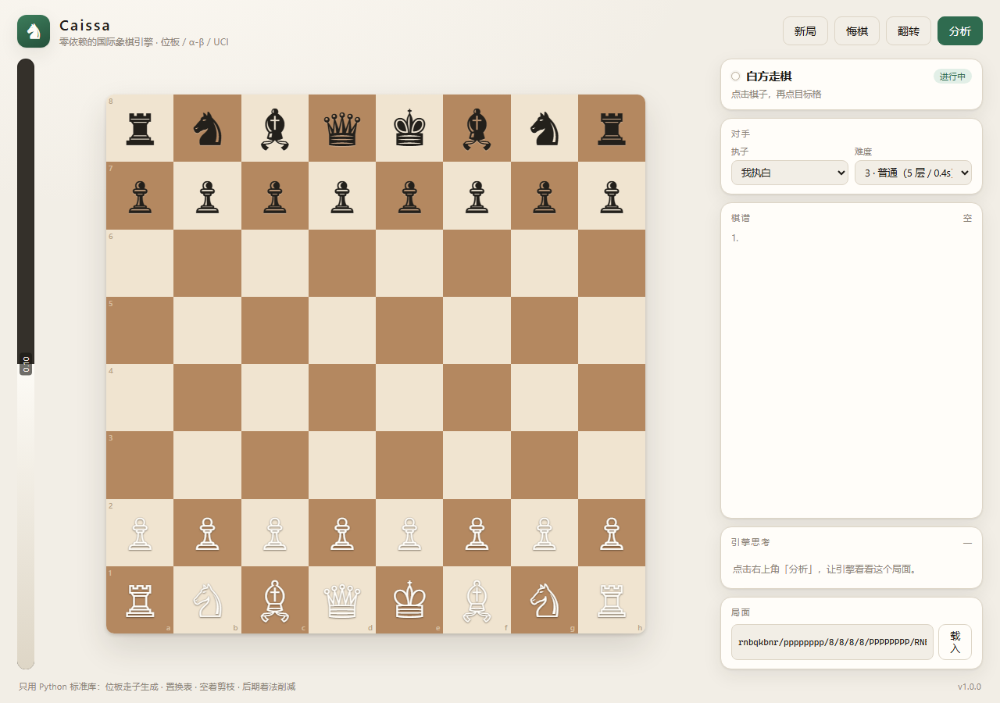
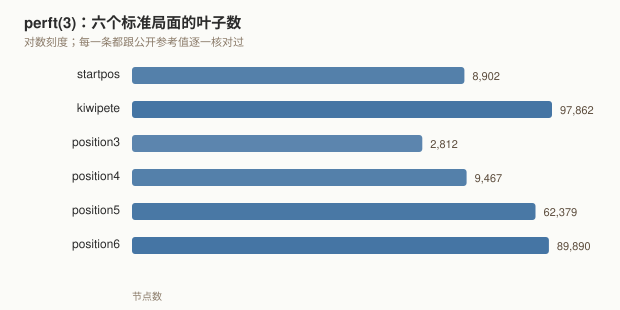
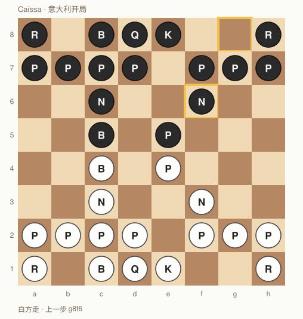
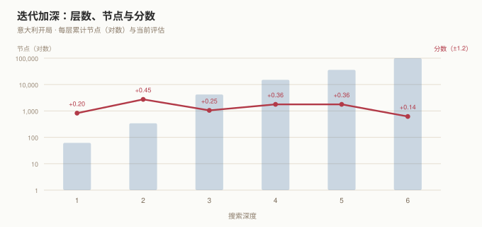

# Caissa

**零依赖的国际象棋引擎与分析工作台。** 走子生成、局面评估、α-β 搜索、UCI 协议、
网页棋盘——全部只用 Python 标准库，连 `pip install` 都不需要。

[](https://github.com/18971181532/caissa/actions/workflows/tests.yml)




Caissa 是国际象棋的缪斯。这个项目用她的名字，做一件很具体的事：把"一个能下棋的
引擎"拆到每一颗螺丝都自己拧一遍——从 64 个格子的位运算，到把 4 百万个叶子节点数
清楚的 perft，再到浏览器里能点击走子的工作台。

## 项目简介

棋类引擎是个很适合练手的题目：它有**唯一正确的答案**（perft 的节点数可以对答案），
也有**没有上限的优化空间**（搜索剪枝、着法排序、评估权重）。规则写错一位，数字立刻
对不上；剪枝写错一处，引擎就会自杀送后。这种"错了马上知道"的反馈，是别的小项目
很难给的。

所以这个项目的目标不是做一个 Stockfish，而是做一个**每一行都能解释清楚**的引擎：

- 不引入第三方库，不调用外部引擎，不下载残局库；
- 所有魔数都有出处，所有剪枝都能在代码里找到对应的注释；
- 正确性用公开 perft 数字验收，强度用自对弈和基线对手衡量；
- 对外提供多种入口：命令行、UCI 协议、HTTP + 网页，共用同一套门面。

## 功能

### 棋规

- 完整的 FEN 解析与回写，含易位权与过路兵格的合法性修剪
- 全部走子类型：易位（含路径受攻击检查）、吃过路兵、四种升变
- 将军 / 将杀 / 逼和 / 五十回合 / 三次重复 / 子力不足
- SAN 记谱的生成与解析，含列/行消歧、`+` `#` 后缀、`0-0` 之类的宽容写法
- PGN 读写：丢弃注释与变例，支持自定义起始局面

### 搜索

- 负极大值 α-β，外套迭代加深与渴望窗口
- 置换表（Zobrist 增量维护，边界类型区分精确值/下界/上界）
- 静态搜索（只扩展吃子与升变），带 delta 剪枝
- 空着剪枝（自动回避纯兵残局）、后期着法削减（LMR）、PVS 重搜
- 杀手着法 + 历史启发 + MVV-LVA 排序
- 时间管理：`movetime`、剩余时钟 + 增量、节点上限，三者可叠加

### 评估

- 中局/残局双套子力-位置表（PST），按阶段线性插值
- 兵形：孤兵、叠兵、通路兵（按推进格数递增）
- 机动性：按子力类型加权，一次遍历完成
- 王的安全、tempo；所有分项可通过 `detail` 字典取出

### 接口

- **CLI**：对局、分析、perft、复盘、对抗、开局库、UCI、起服务
- **UCI**：`uci` / `isready` / `position` / `go` / `stop` / `quit`，搜索跑在独立线程
- **HTTP**：`/api/state`、`/api/move`、`/api/engine`、`/api/perft`，无会话、无状态
- **网页**：DOM 棋盘、点击走子、评估条、棋谱、难度档、FEN 载入
- **Python**：`Coach` 门面把"一次分析"的语义收敛到一处

## 环境与依赖

- Python **3.10+**（用到了 `int.bit_count()`）
- 无第三方依赖，无编译步骤，无需网络
- 操作系统不限；Windows 下终端会自动切 UTF-8，也可以用 `--ascii` 强制 ASCII 棋子
- 浏览器只需支持 ES2020（`fetch`、`async/await`），不需要构建工具

## 安装

```bash
git clone https://github.com/18971181532/caissa.git
cd caissa

python run.py --version     # caissa 1.0.0
python run_tests.py         # 178 个测试，约 5 秒
```

也可以作为包安装（可选，装上后会得到 `caissa` 命令）：

```bash
pip install -e .
caissa search --depth 6
```

## 快速开始

```bash
python run.py play                       # 在终端里跟引擎下棋
python run.py search --depth 8           # 分析初始局面
python run.py perft --depth 3            # 跑标准局面的 perft
python run.py serve --port 8790          # 打开网页工作台
```

`run.py` 只是把项目根加进 `sys.path` 再转给 `caissa.cli`，所以不安装也能跑。

## 使用示例

### 在终端里对局

```bash
python run.py play --color w --level 5
```

输入 `e2e4` 或 `e4` 都认；`hint` 让引擎给建议，`undo` 悔棋，`fen` 打印局面，
`level 7` 调难度，`new` 重开。棋盘用 Unicode 棋子，窄终端可以加 `--ascii`。

### 分析一个局面

```bash
python run.py search --fen "6k1/5ppp/8/8/8/8/8/R5K1 w - - 0 1" --depth 6
```

```
搜索完成  1 层 / 选择深度 1
──────────────────────────────────────────────────────────────────────────
 层      分数        节点     用时     节点/秒  主变
  1        #1          20    0.00s         55k  Ra8#
──────────────────────────────────────────────────────────────────────────
最佳着法 Ra8# (a1a8)   #1
节点 20 + 静态搜索 17  ·  54k 节点/秒  ·  总用时 0.00s
```

找到最短杀之后会提前停——继续加深也不会让杀更快，这是搜索里的一个显式判断。

普通局面下会看到逐层的主变：

```bash
python run.py search --depth 6
```

```
 层      分数        节点     用时     节点/秒  主变
  1     +0.48          26    0.00s         32k  Nc3
  2     +0.10         106    0.00s         32k  Nc3 Nc6
  3     +0.48         717    0.02s         34k  Nc3 Nc6 Nf3
  4     +0.10       2,428    0.09s         27k  Nc3 Nc6 Nf3 Nf6
  5     +0.15       4,967    0.18s         28k  Nc3 Nc6 Nf3 Nf6 d4
  6     +0.10       9,969    0.41s         24k  Nc3 Nc6 Nf3 Nf6 d4 d5
```

### 校验棋规

```bash
python run.py perft --depth 3
```

六个标准局面逐一跑完，和公开参考值比对。这是整个项目最硬的一条测试：走子、吃子、
易位、吃过路兵、升变、将军回避，任何一处写错，数字立刻不对。



### 复盘 PGN

```bash
python run.py pgn --in examples/opera-game.pgn
```

```
33 个着法 · 17 回合
1.e4 e5 2.Nf3 d6 3.d4 Bg4 4.dxe5 Bxf3 5.Qxf3 dxe5 ... 17.Rd8#

    a  b  c  d  e  f  g  h
  ┌───┬───┬───┬───┬───┬───┬───┬───┐
8 │   │ ♞ │   │ ♖ │ ♚ │ ♝ │   │ ♜ │ 8
  ...
轮到黑方  ·  将军  ·  将杀  ·  评估 #
```

### 跟基线对手下一批棋

```bash
python run.py arena --games 20 --vs material --movetime 0.05
```

### 接到象棋 GUI 上

```bash
python run.py uci
```

在 Arena / CuteChess / Nibbler 里添加一个 UCI 引擎，命令填
`python <绝对路径>/run.py uci`。支持 `Hash` 选项，`stop` 立即生效。

### Python API

```python
from caissa import Position, Engine, Limits, Coach, to_san

pos = Position("r1bqk2r/pppp1ppp/2n2n2/2b1p3/2B1P3/2N2N2/PPPP1PPP/R1BQK2R w KQkq - 4 4")
engine = Engine(megabytes=32)

result = engine.search(pos, Limits(depth=6))
print(to_san(pos, result.best_move), result.score, result.pv_uci)

coach = Coach()
print(coach.analyze(pos.fen(), depth=6)["best_san"])
print(coach.apply(pos.fen(), "Nxe5"))     # UCI 或 SAN 都认
```

### HTTP 接口

```bash
python run.py serve --port 8790 --no-open
```

| 方法 | 路径 | 请求体 | 返回 |
| --- | --- | --- | --- |
| GET | `/api/health` | — | 版本与运行时长 |
| POST | `/api/state` | `{"fen": "..."}` | 合法着法、评估、状态 |
| POST | `/api/move` | `{"fen": "...", "move": "e2e4"}` | 走完之后的局面 |
| POST | `/api/engine` | `{"fen": "...", "depth": 6, "movetime": 0.5}` | 最佳着法、主变、统计 |
| POST | `/api/perft` | `{"fen": "...", "depth": 3}` | 节点数与耗时 |

服务端不保存对局状态：客户端每次都把当前 FEN 带上来。刷新页面不会丢棋，也不需要会话。

## 技术方案

### 棋盘：位板 + 预计算攻击表



每个局面用 16 个 64 位整数表示（`bb[piece]`，`piece = color << 3 | type`），
另存 `occ[2]` 与 `all` 以便快速求"空格"。着法生成全程在位运算上做：

```python
single = (pawns << 8) & not_occ                  # 白兵前进一步
double = ((single & RANK_3) << 8) & not_occ      # 再进一步（只在第三横线起跳）
caps_e = ((pawns << 9) & ~FILE_A) & enemy        # 斜吃，屏蔽 a 列绕回
```

滑子攻击没有用 magic bitboard。魔术数那套的价值在于把攻击压成一次查表，代价是要
搜魔术数、建几十 KB 的表、处理边界；而在 Python 里查表本身就有下标开销，省下来的
时间不足以抵消复杂度。这里用八条预计算射线，配合"最近的阻挡子"截断：

```python
blockers = ray[sq] & occ
first = (blockers & -blockers).bit_length() - 1   # 正方向取最低位
return ray[sq] ^ ray[first]                        # 异或掉尾段
```

### 着法编码

一步棋压进一个整数：`from | to << 6 | promo << 12 | flags << 15`。`flags` 区分吃子、
过路兵、易位、双步——它们决定 `make()` 的副作用（过路兵格、车的移动），所以不能省。

外部输入的 UCI 着法（`e2e4`）看不出这些标记，必须先经过 `Position.resolve()` 对齐到
内部编码。这个边界是踩过坑才划清的：早期直接 `make(parse_uci(...))`，双步不设过路兵格，
易位不挪车，测试里一片"看起来对但就是不对"。

### 搜索

```
迭代加深
└── 渴望窗口（上一层分数 ±22，失败就放宽三倍）
    └── 根节点 PVS
        └── α-β + 置换表 + 空着剪枝 + LMR + 静态搜索
```

几个实现上的取舍：

- **置换表存边界类型**。精确值可以直接用，下界只能抬 α，上界只能压 β；用错会剪掉正解。
  将杀分数要按 ply 做修正，否则同一个杀在不同深度会给出不同的绝对值。
- **空着剪枝要回避纯兵残局**。那种局面里"白送一步"可能反而有利（楚克旺），剪了会误判。
- **LMR 只削减安静着法**，且被将军时不削减；削减后若超过 α 就原深度重搜。
- **超时用异常中断**，`search()` 捕获后保留上一层结果。为了保证调用者的局面不被
  半途而废的 `make()` 污染，搜索在 `pos.clone()` 上干活。

### 评估

中局与残局各一套 PST，按 `phase`（24 为满子力）线性插值。兵形单独算：孤兵、叠兵扣分，
通路兵按推进格数加分。机动性按子力类型加权，且只遍历一次所有己方棋子——早期版本对每个
棋子都调一次 `generate_moves()`，profile 出来评估占了七成时间。

### 三种入口，一个门面

```
CLI ─┐
HTTP ─┼── Coach ── Engine ── Position
UCI ─┘
```

`Coach` 负责"一次搜索"的语义：加锁、跑引擎、把 PV 翻成 SAN、组装统计。CLI 和网页
都只跟它打交道，所以命令行看到的分数和网页上看到的分数一定出自同一段代码。

## 正确性

### perft

`perft(n)` 把整棵着法树数到底。它不关心"这步好不好"，只关心"这步合不合法"，
所以是棋规实现的唯一硬指标。

| 局面 | 1 | 2 | 3 | 4 |
| --- | ---: | ---: | ---: | ---: |
| startpos | 20 | 400 | 8,902 | 197,281 |
| kiwipete | 48 | 2,039 | 97,862 | 4,085,603 |
| position 3 | 14 | 191 | 2,812 | 43,238 |
| position 4 | 6 | 264 | 9,467 | 422,333 |
| position 5 | 44 | 1,486 | 62,379 | 2,103,487 |
| position 6 | 46 | 2,079 | 89,890 | 3,894,594 |

前 3 层六个局面全部进测试；startpos 与 position 3 测到第 4 层，kiwipete 的第 4 层
在开发时手工核对过。startpos 第 5 层（4,865,609）也跑通过，约 17 秒，没有放进 CI。

速度：约 **28.5 万节点/秒**（perft，单线程，Python 3.13 / Windows）。搜索时的
节点/秒会低一个数量级，因为每个节点还要评估、排序、查置换表。

### 搜索



`python run_demos.py search` 会重新生成这张图。上面是意大利开局逐层加深的节点数与
分数——分数在 ±0.5 内来回，符合开局的特征；深度 6 花了 1.6 秒、2.8 万节点。

战术上，一步杀、白吃重子、升变这些局面都在测试里断言了具体着法，而不只是"有个结果"。

### 对抗

`arena` 让引擎跟两个基线对手下棋：

| 对手 | 局数 | 结果 | 用时 |
| --- | ---: | --- | ---: |
| 随机走子 | 20 | 20 胜 0 和 0 负 | 20.0s |
| 一层 + 只吃子 | 20 | 20 胜 0 和 0 负 | 21.9s |

样本很小，说明不了绝对强度，只能说明"搜索和评估确实在起作用"。真正的强度标定需要
几千盘和更强的对手，那超出这个项目的范围。

## 目录结构

```
caissa/
├── caissa/
│   ├── attacks.py     预计算攻击表：马/王/兵的落点，滑子的八条射线
│   ├── board.py       Position：位板、FEN、make/unmake、Zobrist、SEE
│   ├── eval.py        评估：PST、兵形、机动性、王安全
│   ├── tt.py          置换表：边界类型、半清策略
│   ├── search.py      α-β、迭代加深、静态搜索、LMR、空着剪枝
│   ├── san.py         SAN 生成/解析、Game、PGN
│   ├── perft.py       六标准局面与 perft 校验
│   ├── book.py        内置开局库（十几条主线，编译成 Zobrist → 着法）
│   ├── arena.py       对局、基线对手、Elo 估计
│   ├── service.py     Coach 门面：状态、走子、分析
│   ├── server.py      http.server 工作台与 JSON 接口
│   ├── uci.py         UCI 协议（搜索在独立线程）
│   ├── cli.py         子命令：play/search/perft/pgn/arena/book/uci/serve
│   ├── console.py     UTF-8、颜色、宽字符对齐
│   ├── __init__.py    公开 API 与版本号
│   └── __main__.py    python -m caissa
├── web/
│   ├── index.html     工作台结构
│   ├── style.css      版式与棋盘样式
│   └── app.js         DOM 棋盘、点击走子、接口调用
├── tests/             11 个测试模块，178 个用例
│   ├── test_attacks.py  test_board.py   test_eval.py    test_perft.py
│   ├── test_search.py   test_tt.py      test_san.py     test_book.py
│   └── test_arena.py    test_service.py test_uci.py     test_server.py
├── examples/
│   ├── opera-game.pgn      Morphy 1858，33 着法到将杀
│   ├── immortal-game.pgn   Anderssen 1851，45 着法到将杀
│   └── README.md
├── docs/                  README 用的图：棋盘、perft、搜索曲线、界面截图
├── run.py                 免安装入口
├── run_tests.py           跑全部测试
├── run_demos.py           跑演示并重画 docs/ 里的图
├── pyproject.toml
└── LICENSE
```

## 开发与测试

```bash
python run_tests.py            # 全部
python run_tests.py tests.test_perft -v
python run_demos.py            # 所有演示，约 20 秒
python run_demos.py board perft search
```

测试分成四层：攻击表与棋规（纯函数，快）、perft（慢一点，但只跑浅层）、搜索与评估
（断言具体战术着法）、接口（UCI 用字符串喂，HTTP 真的起服务）。

CI 在 Python 3.10 / 3.11 / 3.12 上各跑一遍 `run_tests.py`，见
`.github/workflows/tests.yml`。

## 已知限制

- **强度有限**。没有神经网络评估，没有开局库之外的布局知识，没有残局库。对随机和
  一层对手稳定取胜，但离"能和人对弈"还有距离；中局容易在长转换里迷路。
- **单线程**。Python 的 GIL 让多线程搜索得不偿失，Lazy SMP 没有实现。
- **置换表用字典**。每个条目是一个元组，内存开销远大于 C 引擎的 16 字节条目；
  表满时整表半清，会有轻微的质量抖动。
- **长将/重复的判定是保守的**。搜索里用 `is_repetition(1)` 直接判和，可能错过
  "先重复再变着"的策略。
- **网页端不做长将检测的 UI 提示**，只在状态里显示"和棋"。
- **未实现 Chess960**，虽然着法编码留了位置。

## 许可

MIT，见 [LICENSE](LICENSE)。

两局示例 PGN 属于公共领域，记谱取自通行版本。
